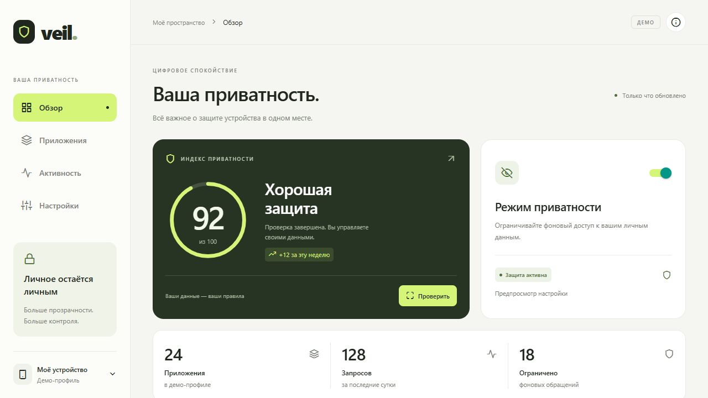

# VEIL — приватность устройства

Мобильный визуальный прототип на React Native, Expo и TypeScript. Спокойная светлая палитра, графитовые поверхности, лаймовые акценты и настоящие иконки Feather. Адаптирован для телефона, планшета и браузера.



## Запуск

Нужны Node.js (LTS, совместимый с Expo SDK 58) и npm.

```bash
npm ci
npm start
```

Откройте проект в совместимой версии Expo Go. Для браузера:

```bash
npm run web
```

## Экраны

- **Обзор** — индекс приватности, демонстрационная проверка, режим приватности, сводка, рекомендации и последние события.
- **Приложения** — поиск, фильтры по разрешениям, карточки шести приложений и окно управления их доступом.
- **Активность** — журнал событий с фильтрацией разрешённых и ограниченных запросов.
- **Настройки** — переключатели режима приватности, уведомлений и блокировки, информация о проекте.

На экранах шириной от 1000 px используется боковая навигация. На телефоне — нижняя панель. Данные и настройки общие для разделов в пределах одной сессии.

## Демонстрационный режим

Это учебный интерфейс, не средство защиты. Показатели, события и приложения вымышлены для демонстрации. Проверка имитирует процесс и меняет оценку с 86 на 92. Приложение не читает список установленных приложений, не меняет системные разрешения, не запускает VPN и не запрашивает доступ к датчикам. Настройки сбрасываются при перезапуске. В сводке изображён пример устройства с 24 приложениями; в каталоге представлены 6 карточек.

## Проверка и сборка

```bash
npm run typecheck
npm run lint
npm run build
```

Веб-сборка появится в папке `dist`. Её нужно отдавать через HTTP-сервер, например `npx serve dist`, а не открывать двойным кликом.

## Структура

```text
src/app/       Маршрут Expo Router и корневой layout
src/data.ts    Типы и демонстрационные данные
App.tsx        Адаптивный интерфейс, компоненты и состояние
assets/        Иконки приложения
```

## Сценарий демонстрации

1. Откройте обзор и запустите проверку.
2. Перейдите к приложениям, выберите «С риском».
3. Откройте Instagram и переключите доступ к геолокации.
4. Посмотрите журнал с фильтром «Ограничено».
5. Откройте настройки и измените режим приватности.
6. Вернитесь в обзор: состояние режима синхронизировано.

## Технологии и материалы

React Native, Expo SDK 58, TypeScript, Expo Router, react-native-svg, Feather через @expo/vector-icons. Подключение маршрутизации соответствует [официальной документации Expo](https://docs.expo.dev/router/installation/).

При выборе стека учтены предоставленные материалы лабораторных работ по мобильным приложениям. Их задания не заявляются выполненными: объём проекта — визуальный прототип по теме приватности устройства. Исходные презентации в репозиторий не включены.

